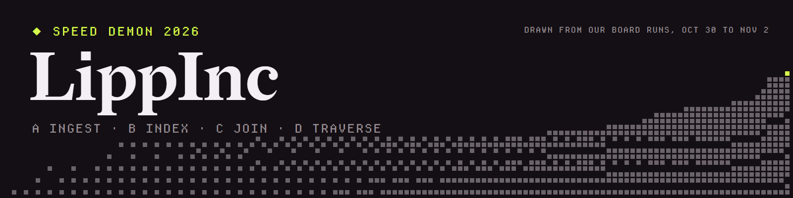

# Speed Demon 2026: LippInc

Four programs, one per track. Each produces byte-identical output to the organisers' reference program, about 1,000 to 2,100 times faster, with no dependencies beyond the language's standard library.

| Track | The job | Language | Reference T | Best board T | M | K | Board run |
|---|---|---|---|---|---|---|---|
| [A: Ingest](track-a/README.md) | 3.1 M HTTP log lines to request counts, p50, p95, p99 and 5xx rates per hour and endpoint | Rust | 32.05 s | 15.35 ms | 14.53 MB | 58.99 | run-f4bf9c49660d |
| [B: Index](track-b/README.md) | 50,000 boolean and phrase queries over 254 MB of documents | C | 56.35 s | 53.82 ms | 43.27 MB | 51.02 | run-9066adc75374 |
| [C: Join](track-c/README.md) | 202 MB of quoted CSV joined to its regions and aggregated per country | C | 14.44 s | 14.32 ms | 8.07 MB | 56.60 | run-6d3cdfadd754 |
| [D: Traverse](track-d/README.md) | 2,000 shortest-path queries on a 5 M-edge weighted graph | C | 72.69 s | 64.3 ms | 60.4 MB | 37.30 | run-7d9634c6a75e |

Each number is the best [live-board](https://speeddemon.dev/board) run of the code in this repository; each track's README gives its spread, since the board is noisy while its queue is busy.

## For the judges

| Criterion | Where to look | Fastest check |
|---|---|---|
| Code quality | One source file per track: [src/main.rs](track-a/src/main.rs), [bindex.c](track-b/bindex.c), [join.c](track-c/join.c), [traverse.c](track-d/traverse.c) | Read the top comment, then any function: its comment says why it is shaped that way |
| Technique | The approach and the trick table in each track's README: [A](track-a/README.md), [B](track-b/README.md), [C](track-c/README.md), [D](track-d/README.md) | Each trick links to the lines that do it |
| Optimisation log | [A](track-a/PERF.md), [B](track-b/PERF.md), [C](track-c/PERF.md), [D](track-d/PERF.md) | Pick any row: it names the commit, the board run and the change, and failed experiments have their numbers too |

## Reproduce

`check.py` is the organisers' local check from their template, unchanged: it builds a track offline, runs it with the board's Docker settings and compares the output's sha256. With seed 1's full data in `data/<track>`:

```bash
python3 check.py a --data data/a --expected 495ca09682b9673ef836a506496177680bb4a3af54255174befddb1f83481cd3
python3 check.py b --data data/b --expected f86973c210228141bcb6f1f1b10188ad2a9b65f71e7cd7cf4590b38de4e80927
python3 check.py c --data data/c --expected d8088b1cd42ba1338b1345b107b55db7b96ef1f5066f3ff64fd26a8912a0f536
python3 check.py d --data data/d --expected a23dbdf0a3e49cc8901310a9ee1dc6a9a569a85297b6da75c2a7002cb2ed277e
```

## Honest limits

- **A:** more than 2,047 distinct endpoints abort on an assert (the spec says exactly 1,842), and timestamps outside the spec's 72-hour window are not handled.
- **B:** a token is matched by a 32-bit tag, not its text, so a dataset has about a 0.03 % chance of a wrong answer (derived, not measured).
- **C:** a name is identified by about 45 bits of hash, so two names can merge with odds of about 1.4e-4 per run, and a name over 30 raw bytes is not handled, about 3e-4 per dataset.
- **D:** built for this generator's shape and scale: node ids must stay below 1,835,008, and parse cells have room for the expected fill plus 8 standard deviations with no bounds check.

Each track's README has the full list, with what it assumes about the machine.

## Also here

- [reports/](reports): the board's own records of measured commits, verbatim, one folder per track.
- MIT licence, see [LICENSE](LICENSE).
